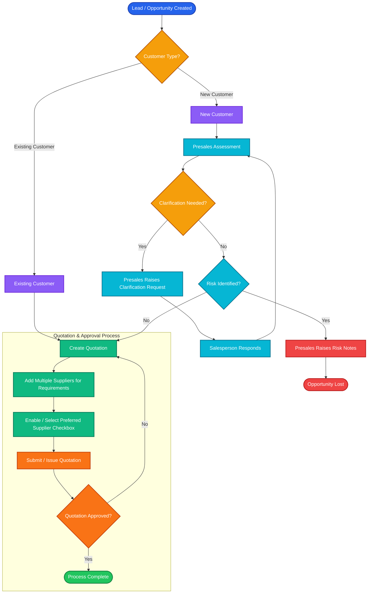

# Opportunity & Quotation Sales Process

## Process Flow

## Flow Summary

1. **Lead / Opportunity Created**
2. Check **Customer Type**
   - Existing Customer → Create Quotation
   - New Customer → Presales Assessment
3. **Presales Assessment**
   - Clarification Needed?
     - Yes → Presales Raises Clarification Request → Salesperson Responds → Presales Assessment
     - No → Risk Check
4. **Risk Identified?**
   - Yes → Presales Raises Risk Notes → Opportunity Lost
   - No → Create Quotation
5. **Quotation & Approval Process**
   - Add Multiple Suppliers for Requirements
   - Enable / Select Preferred Supplier Checkbox
   - Submit / Issue Quotation
   - Quotation Approved?
     - No → Create Quotation
     - Yes → Process Complete
